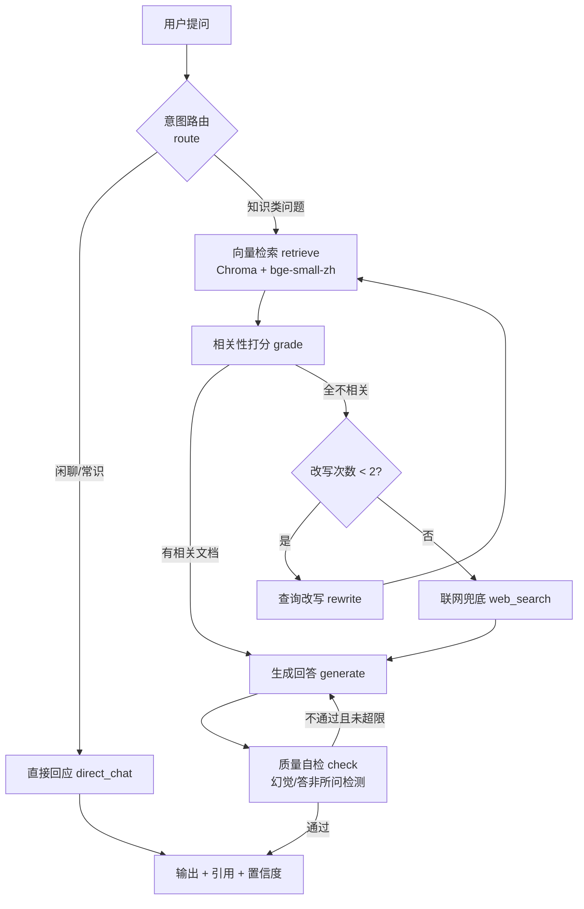

# Agentic RAG 知识库问答系统

一个**带自反思能力的纠错式 RAG（CRAG + Self-RAG）**项目：检索结果先打分、不合格自动改写重试、再不行联网兜底，回答生成后还有幻觉自检——并用评测数据量化它对朴素 RAG 的提升。

> 区别于「检索 → 生成」一条道走到黑的朴素 RAG，本项目把 RAG 做成了一个 **LangGraph 状态机 Agent**，且全流程决策可视化、可量化评测。

## 架构



## 技术栈

| 组件 | 选型 | 说明 |
|---|---|---|
| Agent 编排 | LangGraph | 条件边 + 循环的状态机，CRAG 模式 |
| 对话模型 | DeepSeek `deepseek-chat` | OpenAI 兼容接口 |
| Embedding | `bge-small-zh-v1.5`（本地 CPU） | 无 GPU 环境友好，数据不出本机 |
| 向量库 | Chroma（本地持久化） | 免 Docker，cosine 相似度 |
| 后端 | FastAPI + SSE 流式 | 每一步 Agent 决策实时推送 |
| 前端 | 原生 HTML/JS（无构建链） | 决策时间线 + 置信度 + 引用来源 |

## 快速开始

```bash
cd E:\software\agentic-rag

# 1. 创建虚拟环境（已创建则跳过）
E:\anaconda3\python.exe -m venv .venv

# 2. 安装依赖
.venv\Scripts\pip install -r requirements.txt -i https://pypi.tuna.tsinghua.edu.cn/simple

# 3. 配置 API Key：编辑 .env，填入 DEEPSEEK_API_KEY（https://platform.deepseek.com）

# 4. 下载本地 Embedding 模型（~95MB，走 hf-mirror 镜像；HF 匿名下载常受限速）
.venv\Scripts\python.exe scripts\download_model.py

# 5. 示例语料入库
.venv\Scripts\python.exe scripts\ingest_corpus.py

# 6. 启动服务
.venv\Scripts\python.exe -m uvicorn app.main:app --port 8000
```

打开 http://127.0.0.1:8000 即可使用。

## 演示要点（面试可讲的故事）

1. **陷阱题**：问「员工年假有几天？」——知识库里同时有**已废止的 V2.0**（3 天）和**现行 V3.0**（5/8/12 天）。朴素 RAG 可能召回旧版直接回答；本系统的打分节点会识别文档状态标记，旧版被过滤，回答基于现行制度。
2. **改写重试**：口语化提问召回失败时，观察右侧时间线出现 `查询改写 → 重新检索` 循环。
3. **联网兜底**：问「今天上海天气怎么样」，检索全部不合格后走 `web_search` 兜底并标注来源，置信度降为「中」。
4. **幻觉自检**：生成节点输出后，自检节点核对「每条陈述是否有资料支撑」，不通过自动重新生成并携带失败原因。
5. **量化评测**：`scripts/run_eval.py` 输出朴素 RAG vs CRAG Agent 的分类型对比表（见 `data/eval/report.md`）。

## 评测

```bash
.venv\Scripts\python.exe scripts\run_eval.py           # 全部 20 题
.venv\Scripts\python.exe scripts\run_eval.py --limit 5 # 快速验证
```

评测集 20 题：`simple`（单跳事实）/ `multi_hop`（多跳推理）/ `version_trap`（新旧版本陷阱）/ `out_of_scope`（超纲拒答）/ `chitchat`（无需检索）。

## 项目结构

```
├── app/
│   ├── main.py            # FastAPI 入口
│   ├── config.py          # .env 配置加载
│   ├── llm.py             # DeepSeek 客户端（JSON 容错解析）
│   ├── agent/
│   │   ├── graph.py       # LangGraph 状态机组装
│   │   ├── nodes.py       # 路由/检索/打分/改写/联网/生成/自检 节点
│   │   ├── prompts.py     # 各节点中文提示词
│   │   └── state.py       # 状态定义（trace 用 operator.add 归并）
│   ├── rag/
│   │   ├── loader.py      # md/txt/pdf 加载 + 分块（含废止状态识别）
│   │   ├── embeddings.py  # bge 本地向量化
│   │   ├── store.py       # Chroma 封装
│   │   └── baseline.py    # 朴素 RAG 基线（对照组）
│   └── api/               # /api/chat (SSE) / /api/ingest / /api/rebuild
├── frontend/              # 单页应用：聊天 + 决策时间线 + 知识库管理
├── data/
│   ├── corpus/            # 虚构公司「星野科技」示例语料 12 篇（含陷阱文档）
│   └── eval/questions.json  # 20 题评测集
└── scripts/               # 入库脚本 + 对比评测脚本
```

## 设计决策备忘

- **trace 用 `Annotated[list, operator.add]` 归并器**：节点只返回增量事件，SSE 逐事件推送，前端时间线实时出现。
- **打分一次调用评完所有候选**：省 token 省延迟；打分失败时降级为「全部保留」，不让 LLM 单点故障中断主流程。
- **Embedding 放本地而非 API**：DeepSeek 无 embedding 接口；本地小模型对中文短文档效果足够，且零成本、数据不出本机。
- **改写上限 2 轮 + 重生成上限 1 次**：用配置控制循环预算，防止 Agent 失控空转。
